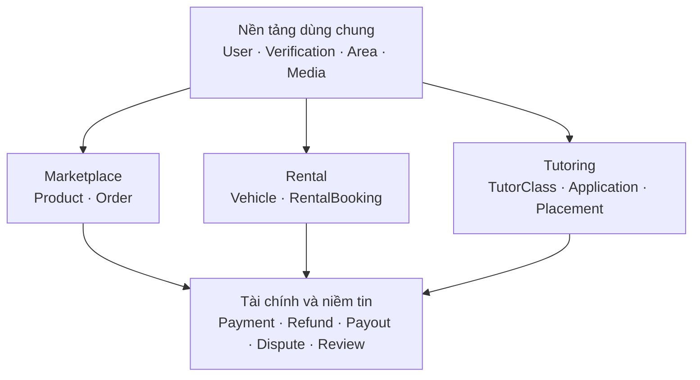

# CampusLoop — Phân tích và thiết kế database cho hệ sinh thái 3 phân hệ

**Phạm vi:** Chợ đồ cũ, thuê xe máy P2P và kết nối gia sư  
**Hệ quản trị:** PostgreSQL  
**ORM hiện tại:** Prisma  
**Ngày đối chiếu mã nguồn:** 23/07/2026  
**Phiên bản:** `USER_CHUNG_V2`

> Bảng `User` **không có `schoolId`**. Nếu một bản ERD vẫn đặt `schoolId` trực tiếp trong `User`, đó là bản cũ và không đúng với yêu cầu người dùng chung.

## 1. Kết luận kiến trúc

CampusLoop nên tiếp tục dùng **một PostgreSQL và một Prisma schema**, nhưng chia model theo các miền nghiệp vụ rõ ràng:



Ba phân hệ **không dùng chung một bảng đơn hàng**:

- `Order` chỉ phục vụ chợ đồ cũ.
- `RentalBooking` chỉ phục vụ thuê xe.
- `TutorPlacement` chỉ phục vụ kết quả chốt gia sư.
- `ServiceTransaction` là “mã hồ sơ chung” để thanh toán, hoàn tiền, tranh chấp, hỗ trợ và đánh giá có thể liên kết thống nhất.

Đây là mô hình **modular monolith**. Nó phù hợp với quy mô và đội ngũ hiện tại hơn microservice, đồng thời tránh việc ba phân hệ bị trộn trạng thái vào nhau.

### 1.1. Một `User` chung cho toàn bộ cộng đồng

CampusLoop lấy sinh viên làm nhóm trọng tâm nhưng không được giả định mọi tài khoản đều là sinh viên. `User` đại diện chung cho:

- sinh viên, cựu sinh viên và cán bộ trường;
- phụ huynh/người giám hộ;
- người dân mua hoặc bán đồ cũ;
- người thuê xe hoặc chủ xe;
- người đăng ký làm gia sư;
- operator và admin vận hành hệ thống.

Một người chỉ có một `User.id`. Ba phân hệ tham chiếu cùng ID đó:

```text
Product.sellerId         → User.id
Order.buyerId            → User.id
Vehicle.ownerId          → User.id
RentalBooking.renterId   → User.id
GuardianContact.linkedUserId → User.id
TutorProfile.userId      → User.id
```

Không tạo `StudentUser`, `ParentUser`, `RentalUser` hoặc `MarketplaceUser`.

`User` chỉ giữ dữ liệu tài khoản dùng chung: tên hiển thị, email/số điện thoại đăng nhập, mật khẩu băm, avatar, khu vực mặc định, quyền hệ thống và trạng thái tài khoản. Các dữ liệu khác được tách ra:

```text
User
├── PrivateUserProfile       thông tin pháp lý và địa chỉ riêng tư
├── UserAffiliation          sinh viên, phụ huynh, cộng đồng...
├── UserAcademicProfile      chỉ người có hồ sơ học tập
├── UserVerification         CCCD, bằng lái, sinh viên, giấy tờ xe...
├── UserServiceAccess        quyền dùng từng phân hệ
└── UserReputationSummary    uy tín riêng theo từng phân hệ
```

`email` và `phoneE164` đều có thể nullable, nhưng database phải bảo đảm tài khoản có ít nhất một kênh đăng nhập. `schoolId` không còn nằm trong `User`; người ngoài vẫn tạo tài khoản bình thường.

## 2. Căn cứ từ schema và mã nguồn hiện tại

Các nguồn đã đối chiếu:

- [Prisma schema hiện tại](https://github.com/nhukhoalofi/CampusLoop-BE/blob/main/prisma/schema.prisma)
- [OrdersService hiện tại](https://github.com/nhukhoalofi/CampusLoop-BE/blob/main/src/modules/orders/orders.service.ts)
- [CheckoutService hiện tại](https://github.com/nhukhoalofi/CampusLoop-BE/blob/main/src/modules/checkout/checkout.service.ts)
- [CheckoutDto hiện tại](https://github.com/nhukhoalofi/CampusLoop-BE/blob/main/src/modules/checkout/dto/checkout.dto.ts)
- [API client của Frontend](https://github.com/dieuhoale6406-code/CampusLoop-FE/blob/main/lib/api.ts)
- [Data source của Frontend](https://github.com/dieuhoale6406-code/CampusLoop-FE/blob/main/lib/data-source.ts)
- Tài liệu nghiệp vụ 40 trang của nhóm: `CampusLoop_Tai_Lieu_Mo_Ta_Chi_Tiet_Luong_Hoat_Dong`.

Schema hiện tại có 27 model. Phần tài khoản, trường học, chợ đồ cũ và dữ liệu học thuật đã có nền tương đối tốt; Rental và Tutoring chưa có model nghiệp vụ riêng.

### 2.1. Các model nên giữ

| Nhóm | Model |
|---|---|
| Tài khoản | `User`, `VerificationOtp` |
| Trường học | `School`, `Faculty`, `Major`, `UserAcademicProfile` |
| Marketplace | `Category`, `Product`, `CartItem`, `Order`, `OrderStatusLog`, `CampusLoopPoint` |
| Hỗ trợ hiện có | `Notification`, `Report`, `SupportTicket`, `SupportTicketMessage`, `SupportTicketAttachment` |
| Học thuật/RAG | `CurriculumVersion`, `Course`, `CourseMaterial`, `CourseExamGuide`, `AcademicSource`, `AcademicKnowledgeDocument`, `AcademicKnowledgeChunk` |

Các model học thuật/RAG phải được giữ tách biệt. `UserAcademicProfile` có thể bổ trợ hồ sơ gia sư, nhưng `Course` hoặc `AcademicKnowledgeDocument` không phải là lớp gia sư.

### 2.2. Các vấn đề cần sửa trong schema hiện tại

| Vấn đề hiện tại | Rủi ro | Hướng xử lý |
|---|---|---|
| `User.schoolId` nằm trực tiếp trong tài khoản | Ngầm bắt mọi người là sinh viên, không phù hợp với phụ huynh và người ngoài | Bỏ khỏi `User`; trường học nằm trong `UserAcademicProfile` hoặc `UserAffiliation` |
| `User` chỉ có email, chưa có số điện thoại | Khó phục vụ phụ huynh/người ngoài và các nghiệp vụ cần xác minh liên hệ | Thêm `phoneE164`, `emailVerifiedAt`, `phoneVerifiedAt`; bắt buộc có ít nhất email hoặc số điện thoại |
| Họ tên pháp lý, ngày sinh và địa chỉ nếu đưa vào `User` sẽ dễ bị trả nhầm qua API | Lộ dữ liệu cá nhân giữa các phân hệ | Tách `PrivateUserProfile`; `User` chỉ giữ `displayName` công khai |
| `User.area`, `School.area`, `Product.area` là chuỗi tự do | Trùng tên, sai chính tả, khó lọc theo quận/phường | Tạo `Area` cha–con và dùng `areaId` |
| `User.verificationStatus` chỉ có một trạng thái | Không thể biểu diễn riêng sinh viên, CCCD, bằng lái, hồ sơ gia sư | Tạo `UserVerification` theo từng loại |
| `reputationScore` và số đơn nằm trực tiếp trên `User` | Điểm chợ đồ cũ bị hiểu thành điểm chủ xe/gia sư | Tạo `UserReputationSummary` theo dịch vụ |
| `Product.images` là `String[]` | Không có thứ tự, ảnh bìa, hash, quyền truy cập, metadata | Dùng `MediaAsset` + `ProductMedia` |
| `Review` chỉ gắn với `Order` | Không đánh giá được thuê xe hoặc gia sư | Gắn `Review` với `ServiceTransaction` |
| `SupportTicket` chỉ có `relatedOrderId` và `relatedProductId` | Mỗi dịch vụ mới lại phải thêm cột | Dùng `transactionId` |
| `NotificationType` liệt kê cứng sự kiện Marketplace | Enum sẽ phình to khi thêm Rental/Tutoring | Dùng `eventKey`, `transactionId`, `actionUrl`, `actionDueAt` |
| `SupportTicketAttachment.fileUrl` | Có thể làm lộ tài liệu riêng tư | Dùng `MediaAsset.storageObjectKey` và signed URL |
| `Order` chưa có thời hạn giữ và phiên bản | Đơn treo, chuyển trạng thái đồng thời | Thêm `holdExpiresAt`, `version`, status log |
| `CheckoutDto.paymentMethod` không được lưu/xử lý | Giao diện có chọn phương thức nhưng database không có nguồn sự thật | Tạo `PaymentIntent` |
| FE có chỗ tự quay về mock khi API lỗi | Dữ liệu giao diện có thể không phản ánh database | Tắt fallback mock trong production |

### 2.3. Lỗi cạnh tranh khi đặt sản phẩm

`OrdersService.create()` hiện đọc sản phẩm `APPROVED`, tạo `Order`, sau đó mới đổi sản phẩm thành `ORDERED`. Hai request gần đồng thời có thể cùng đọc được `APPROVED`.

Phải bảo vệ ở cả hai lớp:

1. Update có điều kiện trong transaction:

```sql
UPDATE products
SET status = 'RESERVED', updated_at = now()
WHERE id = $1 AND status = 'APPROVED';
```

Nếu số dòng cập nhật bằng 0, sản phẩm vừa bị người khác giữ.

2. Partial unique index:

```sql
CREATE UNIQUE INDEX uq_orders_one_active_per_product
ON orders(product_id)
WHERE status IN (
  'PENDING_CONFIRMATION',
  'CONFIRMED',
  'WAITING_DROP_OFF',
  'IN_TRANSIT',
  'READY_FOR_PICKUP',
  'DISPUTED'
);
```

## 3. Nguyên tắc thiết kế database mục tiêu

### 3.1. Role không phải vai trò nghiệp vụ

Giữ:

```text
USER | OPERATOR | ADMIN
```

Không thêm `TUTOR`, `RENTER`, `VEHICLE_OWNER`, `BUYER`, `SELLER` vào `Role`. Một người có thể đồng thời mua đồ, đăng xe và làm gia sư. Khả năng tham gia từng dịch vụ được thể hiện bằng:

- `TutorProfile`
- `Vehicle.ownerId`
- `UserServiceAccess`
- các loại `UserVerification`

Tương tự, không thêm `STUDENT` hoặc `PARENT` vào `Role`. Đây là quan hệ xã hội/nghề nghiệp, được lưu nhiều giá trị trong `UserAffiliation`:

```text
STUDENT
PARENT_GUARDIAN
ALUMNI
STAFF
COMMUNITY_MEMBER
```

`UserAffiliation` phục vụ huy hiệu, thống kê và chính sách ưu đãi; nó không tự cấp quyền giao dịch. Quyền cuối cùng phải dựa vào `UserServiceAccess`, trạng thái tài khoản và xác minh cần thiết cho hành động.

### 3.1.1. Dữ liệu công khai và dữ liệu riêng tư của người dùng

Backend chỉ được trả hồ sơ công khai cho ba phân hệ:

```text
User.id
User.displayName
User.avatarMediaAssetId
User.defaultAreaId
User.accountStatus
User.createdAt
UserAffiliation đã VERIFIED
UserReputationSummary của đúng serviceType
```

Không trả email, số điện thoại, họ tên pháp lý, ngày sinh, địa chỉ chính xác hoặc tài liệu xác minh trong API hồ sơ công khai. Các nghiệp vụ cần liên hệ phải có chính sách riêng, chẳng hạn `ContactAccessGrant` sau khi gia sư thanh toán phí nhận lớp.

### 3.2. Tách trạng thái nghiệp vụ và trạng thái tiền

Ví dụ một đơn thuê xe đã `COMPLETED` nhưng payout cho chủ xe có thể vẫn `FAILED`. Vì vậy:

- Trạng thái Rental nằm ở `RentalBooking`.
- Trạng thái thanh toán nằm ở `PaymentIntent`.
- Trạng thái hoàn tiền nằm ở `Refund`.
- Trạng thái giải ngân nằm ở `Payout`.
- Trạng thái khiếu nại nằm ở `DisputeCase`.

Không đưa `PAID`, `REFUNDED`, `PAID_OUT` vào status của đơn thuê hoặc lớp gia sư.

### 3.3. Snapshot dữ liệu tại thời điểm giao dịch

Mọi giao dịch phải giữ bản chụp dữ liệu quan trọng:

- `Order.productSnapshot`
- `RentalBooking.vehicleSnapshot`
- `RentalBooking.pricingSnapshot`
- `RentalBooking.termsSnapshot`
- `TutorApplication.tutorProfileSnapshot`
- `TutorPlacement.placementFeeSnapshot`

Nếu người bán đổi giá, chủ xe sửa điều khoản hoặc gia sư cập nhật hồ sơ sau đó, giao dịch cũ vẫn phản ánh đúng thỏa thuận ban đầu.

### 3.4. Lịch sử phải append-only

Không sửa/xóa lịch sử trạng thái. Các bảng log:

- `OrderStatusLog`
- `RentalBookingStatusLog`
- `TutorApplicationStatusLog`
- `DisputeStatusLog`
- `AuditLog`

Record tài chính, tranh chấp và lịch sử trạng thái không cascade delete theo `User`.

### 3.5. Dữ liệu riêng tư không dùng URL công khai

Các dữ liệu sau phải ở private object storage:

- CCCD, bằng lái, đăng ký xe, bảo hiểm.
- bảng điểm/chứng chỉ gia sư.
- ảnh/video biên bản nhận–trả xe.
- bằng chứng tranh chấp.

Database chỉ lưu `storageObjectKey`, hash, MIME type và quyền truy cập. Backend tạo signed URL có thời hạn khi người có quyền yêu cầu.

Thông tin phụ huynh/học sinh và biển số đầy đủ phải mã hóa. `phoneHash` và `plateNumberHash` nên dùng HMAC với secret của hệ thống, không dùng SHA thuần vì số điện thoại và biển số có không gian đoán nhỏ.

## 4. Lớp dữ liệu dùng chung

### 4.1. `ServiceTransaction`

Đây là aggregate root chung cho các chức năng xuyên phân hệ:

```text
Order            1 — 1 ServiceTransaction
RentalBooking    1 — 1 ServiceTransaction
TutorPlacement   1 — 1 ServiceTransaction
```

Các bảng sau chỉ cần liên kết với `ServiceTransaction`:

- `PaymentIntent`
- `Payout`
- `DisputeCase`
- `Review`
- `SupportTicket`
- `Notification`

`ServiceTransaction` không thay thế status riêng của ba phân hệ.

### 4.2. `Area`

`Area` dùng quan hệ `parentId`:

```text
Đà Nẵng
└── Hải Châu
    └── Hòa Cường Bắc
        └── Khu vực Đại học Bách khoa
```

Tin công khai chỉ dùng khu vực gần đúng. Địa chỉ chính xác của xe hoặc phụ huynh nằm trong trường mã hóa.

### 4.3. Xác minh nhiều loại

`UserVerification` hỗ trợ:

```text
STUDENT
IDENTITY
DRIVER_LICENSE
VEHICLE_OWNERSHIP
TUTOR_QUALIFICATION
```

`StudentVerification` hiện tại nên được migrate sang `UserVerification(type=STUDENT)`. Trong giai đoạn chuyển đổi có thể giữ bảng cũ và dual-write, sau đó mới bỏ.

Không bắt toàn bộ tài khoản phải có tất cả xác minh. Mỗi hành động kiểm tra đúng loại cần thiết:

| Hành động | Xác minh tối thiểu đề xuất |
|---|---|
| Mua đồ cũ | Email hoặc số điện thoại |
| Đăng bán đồ | Số điện thoại; có thể yêu cầu danh tính theo mức rủi ro |
| Thuê xe | Số điện thoại, danh tính và bằng lái |
| Cho thuê xe | Số điện thoại, danh tính và giấy tờ sở hữu/ủy quyền xe |
| Đăng lớp tìm gia sư | Số điện thoại; danh tính khi áp dụng chính sách an toàn |
| Ứng tuyển gia sư | Hồ sơ gia sư; xác minh sinh viên/năng lực tùy chính sách |

### 4.4. Media dùng chung

`MediaAsset` chứa metadata file; các bảng nối quy định file thuộc ngữ cảnh nào:

- `ProductMedia`
- `VehicleMedia`
- `VehicleDocument`
- `TutorCredential`
- `RentalInspectionMedia`
- `DisputeEvidence`
- `SupportTicketAttachment`

Thiết kế này tránh một bảng media có `entityType/entityId` nhưng không có foreign key thật.

## 5. Marketplace sau khi nâng cấp

Marketplace tiếp tục dùng `Product` và `Order`, không đưa xe hoặc lớp gia sư vào `Product`.

### Thay đổi chính

- `Product.status`: đổi ý nghĩa `ORDERED` thành `RESERVED` rõ ràng hơn.
- `Order`: thêm `transactionId`, `fulfillmentMethod`, `productSnapshot`, `holdExpiresAt`, `version`.
- Thêm `REJECTED` và `EXPIRED` cho `OrderStatus`.
- Chuyển QR giao nhận thành tên rõ nghĩa: `pickupQrCiphertext`, `pickupTokenHash`.
- `Product.images` được migrate sang `ProductMedia`.
- Chống một sản phẩm có nhiều đơn active bằng partial unique index.

### Giữ nguyên quan điểm một Order cho một Product

Checkout nhiều sản phẩm có thể tạo nhiều `Order`. Điều này hợp lý vì:

- sản phẩm có thể thuộc nhiều người bán;
- mỗi người bán xác nhận riêng;
- mỗi sản phẩm có trạng thái giao nhận riêng;
- hoàn tất/hủy/tranh chấp riêng.

Nếu cần hiển thị “một lần checkout”, có thể bổ sung `checkoutGroupId`, nhưng không nên biến `Order` hiện tại thành order nhiều dòng ngay trong migration đầu.

## 6. Rental

### 6.1. Các aggregate chính

| Aggregate | Bảng gốc | Thành phần |
|---|---|---|
| Hồ sơ xe | `Vehicle` | `VehicleMedia`, `VehicleDocument` |
| Lịch xe | `VehicleAvailabilityRule` | `VehicleCalendarBlock` |
| Đơn thuê | `RentalBooking` | status log, inspection, incident |
| Dòng tiền | `ServiceTransaction` | payment, allocation, refund, payout |
| Khiếu nại | `DisputeCase` | evidence, status log |

### 6.2. Chống lịch thuê chồng lấn

Kiểm tra nghiệp vụ:

```text
existing.blockedFrom < requestedEnd
AND existing.blockedUntil > requestedStart
```

Ràng buộc PostgreSQL bắt buộc:

```sql
CREATE EXTENSION IF NOT EXISTS btree_gist;

ALTER TABLE vehicle_calendar_blocks
ADD CONSTRAINT ex_vehicle_calendar_no_overlap
EXCLUDE USING gist (
  vehicle_id WITH =,
  tstzrange(blocked_from, blocked_until, '[)') WITH &&
)
WHERE (status = 'ACTIVE');
```

Dùng khoảng `[)` để đơn kết thúc lúc 10:00 và đơn sau bắt đầu đúng 10:00 không bị coi là chồng lấn. Nếu cần thời gian dọn/kiểm tra xe, backend tăng `blockedUntil` theo buffer.

### 6.3. Khi nào tạo block

- Chủ xe chấp nhận: tạo `PAYMENT_HOLD`, có `expiresAt`.
- Thanh toán thành công: đổi thành `BOOKING`, bỏ thời hạn tự giải phóng.
- Thanh toán hết hạn/từ chối/hủy hợp lệ: `RELEASED`.
- Chủ xe tự khóa: `OWNER_BLOCK`.
- Xe bảo dưỡng/tai nạn: `MAINTENANCE` hoặc `INCIDENT`.

### 6.4. Giá và cọc

`RentalBooking` lưu:

```text
rentalAmount
depositAmount
platformFee
discountAmount
totalAmount
currency
pricingSnapshot
termsSnapshot
```

`PaymentAllocation` tách tổng tiền thành:

```text
RENTAL_FEE
DEPOSIT
PLATFORM_FEE
DAMAGE_FEE
LATE_FEE
```

Không tạo `UserBalance` hoặc ví CampusLoop trong MVP.

### 6.5. Giao nhận

Mỗi booking có tối đa một inspection `PICKUP` và một inspection `RETURN`. Cả hai bên xác nhận độc lập. Ảnh/video lưu trong `RentalInspectionMedia`, không lưu thành mảng URL trên booking.

## 7. Tutoring

Thiết kế bám đúng luồng đã thống nhất:

```text
Phụ huynh tự đăng hoặc admin tiếp nhận lớp hộ
→ đăng lớp ẩn danh
→ gia sư ứng tuyển
→ admin sàng lọc và chốt
→ giữ lớp cho một ứng viên
→ gia sư thanh toán phí nhận lớp
→ mở thông tin phụ huynh
→ liên hệ/học thử
→ kết quả và đánh giá
```

### 7.1. Tách dữ liệu công khai và dữ liệu riêng tư

`TutorClass` chỉ chứa:

- môn, khối lớp, mục tiêu;
- lịch dự kiến;
- hình thức dạy;
- khu vực gần đúng;
- học phí dự kiến;
- phí nhận lớp.

`GuardianContact` chứa dữ liệu mã hóa:

- tên người liên hệ;
- số điện thoại;
- email;
- địa chỉ chính xác;
- consent.

Nếu phụ huynh đã có tài khoản, `GuardianContact.linkedUserId` trỏ đến `User.id` và là duy nhất. Nếu admin nhập lớp hộ người chưa có tài khoản, trường này được để `NULL`; sau này có thể liên kết khi phụ huynh đăng ký. `createdById` lưu người thực hiện thao tác, có thể là chính phụ huynh hoặc admin.

`LearnerProfile` chứa hồ sơ học sinh. Tên hiển thị công khai phải là bí danh hoặc mô tả như “Học sinh lớp 9”, không phải họ tên thật.

### 7.2. Ba lớp trạng thái

`TutorClassStatus`:

```text
DRAFT → PUBLISHED → SCREENING → HELD → FILLED
                       ↘ CANCELLED
FILLED → ARCHIVED
```

`TutorApplicationStatus`:

```text
SUBMITTED → UNDER_REVIEW → SHORTLISTED → SELECTED
              ↘ REJECTED
SUBMITTED/UNDER_REVIEW/SHORTLISTED → WITHDRAWN
```

`TutorPlacementStatus`:

```text
AWAITING_PAYMENT
→ CONTACT_UNLOCKED
→ CONTACTED
→ TRIAL_SCHEDULED
→ ACTIVE
→ COMPLETED
```

Nhánh khác: `EXPIRED`, `CANCELLED`, `DISPUTED`.

### 7.3. Chống chốt nhiều ứng viên cùng lúc

```sql
CREATE UNIQUE INDEX uq_tutor_class_one_active_placement
ON tutor_placements(tutor_class_id)
WHERE status IN (
  'AWAITING_PAYMENT',
  'CONTACT_UNLOCKED',
  'CONTACTED',
  'TRIAL_SCHEDULED',
  'ACTIVE',
  'DISPUTED'
);
```

Khi ứng viên không thanh toán và placement chuyển `EXPIRED`, admin mới chốt ứng viên khác.

### 7.4. Điều kiện mở liên hệ

`ContactAccessGrant` chỉ được tạo trong cùng transaction sau khi webhook hợp lệ chuyển `PaymentIntent` sang `PAID`.

Pseudo-flow:

```text
lock PaymentIntent
→ nếu đã PAID: trả kết quả cũ, không xử lý lại
→ xác minh chữ ký và số tiền
→ update PaymentIntent = PAID
→ update TutorPlacement = CONTACT_UNLOCKED
→ create ContactAccessGrant
→ create Notification
→ commit
```

Không dùng ảnh chụp chuyển khoản để mở liên hệ.

## 8. Thanh toán, hoàn tiền và giải ngân

### 8.1. `PaymentIntent`

Mỗi lần cần thu tiền tạo một intent có:

- `providerPaymentId` unique;
- `idempotencyKey` unique;
- đúng `transactionId`, `payerId`, `purpose`, `amount`, `currency`;
- thời hạn và trạng thái riêng.

Một `ServiceTransaction` có thể có nhiều intent, ví dụ:

- thanh toán ban đầu;
- phí gia hạn;
- phí hư hỏng;
- lần thử thanh toán lại sau khi intent cũ hết hạn.

### 8.2. Webhook idempotency

```sql
CREATE UNIQUE INDEX uq_webhook_provider_event
ON payment_webhook_events(provider, provider_event_id);
```

Webhook gửi lại phải trả kết quả thành công cũ, không tạo thêm payment, grant hoặc payout.

### 8.3. Refund và payout tách riêng

- `Refund`: tiền trả lại người đã trả.
- `Payout`: tiền giải ngân cho người bán/chủ xe.
- Tiền cọc đang tranh chấp khiến `Payout.status = BLOCKED`.
- Không đóng dispute khi refund/payout mới ở `PROCESSING`; chỉ đóng sau trạng thái kết thúc.

## 9. Ràng buộc PostgreSQL bắt buộc

Các ràng buộc dưới đây cần nằm trong raw SQL migration vì Prisma không biểu diễn đầy đủ partial index và exclusion constraint.

```sql
CREATE EXTENSION IF NOT EXISTS btree_gist;

ALTER TABLE users
ADD CONSTRAINT ck_user_has_login_channel
CHECK (email IS NOT NULL OR phone_e164 IS NOT NULL);

ALTER TABLE orders
ADD CONSTRAINT ck_order_different_parties
CHECK (buyer_id <> seller_id);

ALTER TABLE rental_bookings
ADD CONSTRAINT ck_rental_different_parties
CHECK (renter_id <> owner_id);

ALTER TABLE rental_bookings
ADD CONSTRAINT ck_rental_valid_period
CHECK (end_at > start_at);

ALTER TABLE vehicle_calendar_blocks
ADD CONSTRAINT ck_vehicle_block_valid_period
CHECK (blocked_until > blocked_from);

ALTER TABLE reviews
ADD CONSTRAINT ck_review_rating
CHECK (rating BETWEEN 1 AND 5);

ALTER TABLE payment_intents
ADD CONSTRAINT ck_payment_positive
CHECK (amount > 0);

ALTER TABLE payment_allocations
ADD CONSTRAINT ck_allocation_nonnegative
CHECK (amount >= 0);

ALTER TABLE refunds
ADD CONSTRAINT ck_refund_positive
CHECK (amount > 0);

ALTER TABLE payouts
ADD CONSTRAINT ck_payout_amounts
CHECK (
  gross_amount >= 0
  AND fee_amount >= 0
  AND net_amount = gross_amount - fee_amount
);

CREATE UNIQUE INDEX uq_verification_one_current
ON user_verifications(user_id, verification_type)
WHERE status IN ('PENDING', 'VERIFIED');

CREATE UNIQUE INDEX uq_user_affiliation_identity
ON user_affiliations(
  user_id,
  affiliation_type,
  COALESCE(school_id, '00000000-0000-0000-0000-000000000000'::uuid)
);

CREATE UNIQUE INDEX uq_student_code_per_school
ON user_academic_profiles(school_id, student_code_hash);

CREATE UNIQUE INDEX uq_user_service_access
ON user_service_accesses(user_id, service_type);

CREATE UNIQUE INDEX uq_user_reputation_service
ON user_reputation_summaries(user_id, service_type);

CREATE UNIQUE INDEX uq_review_once_per_direction
ON reviews(transaction_id, reviewer_id, reviewee_id);

CREATE UNIQUE INDEX uq_inspection_one_per_type
ON rental_inspections(booking_id, inspection_type);
```

### Ràng buộc tổng allocation

Tổng `PaymentAllocation.amount` phải bằng `PaymentIntent.amount`. PostgreSQL `CHECK` không thể kiểm tra tổng từ bảng khác. Thực hiện bằng một trong hai cách:

1. transaction service tạo intent và toàn bộ allocation cùng lúc, sau đó kiểm tra tổng; hoặc
2. deferred constraint trigger.

Với đội ngũ hiện tại, nên dùng transaction service và test integration trước; chỉ thêm trigger khi có nhu cầu đối soát nghiêm ngặt hơn.

## 10. Index cần có

### Marketplace

```text
products(status, category_id, area_id, created_at DESC)
orders(buyer_id, created_at DESC)
orders(seller_id, created_at DESC)
orders(status, hold_expires_at)
```

### Rental

```text
vehicles(approval_status, availability_status, public_area_id)
rental_bookings(vehicle_id, start_at, end_at)
rental_bookings(renter_id, created_at DESC)
rental_bookings(owner_id, created_at DESC)
vehicle_calendar_blocks(vehicle_id, blocked_from, blocked_until)
```

### Tutoring

```text
tutor_classes(status, subject_id, public_area_id, published_at DESC)
tutor_applications(tutor_class_id, status, submitted_at)
tutor_applications(tutor_profile_id, created_at DESC)
tutor_placements(tutor_id, status, created_at DESC)
```

### Tài chính và vận hành

```text
payment_intents(transaction_id, status)
payment_intents(status, expires_at)
refunds(status, created_at)
payouts(status, available_at)
dispute_cases(status, assigned_to_id, created_at)
notifications(user_id, read_at, created_at DESC)
support_tickets(status, assignee_id, last_message_at DESC)
```

### Người dùng chung

```text
users(email)
users(phone_e164)
users(account_status, created_at DESC)
user_affiliations(user_id, affiliation_type, status)
user_verifications(user_id, verification_type, status)
user_service_accesses(user_id, service_type, status)
user_reputation_summaries(user_id, service_type)
```

Không tạo index cho mọi cột. Theo dõi query thực tế bằng `EXPLAIN ANALYZE` và `pg_stat_statements`.

## 11. Quy tắc xóa và lưu trữ

| Dữ liệu | Chính sách |
|---|---|
| `CartItem` | Có thể cascade delete |
| Media công khai chưa dùng | Soft delete, job dọn sau thời gian chờ |
| `Product`, `Vehicle`, `TutorClass` | Soft delete/status archived |
| `Order`, `RentalBooking`, `TutorPlacement` | Không hard delete |
| Payment, refund, payout | Không hard delete |
| Dispute, evidence, status log | Không hard delete |
| User | Vô hiệu hóa và ẩn danh hóa theo chính sách; không phá lịch sử |

## 12. Thứ tự migration an toàn

### Phase 0 — Sửa Marketplace hiện tại

1. Thêm partial unique index chống một sản phẩm có nhiều đơn active.
2. Đổi luồng giữ sản phẩm thành atomic conditional update.
3. Thêm `holdExpiresAt`, `EXPIRED`, job giải phóng đơn hết hạn.
4. Bổ sung `fulfillmentMethod`; xử lý rõ giao trực tiếp và CampusLoop Point.

### Phase 1 — Nền tảng dùng chung

1. Thêm `displayName`, `phoneE164`, trạng thái xác minh liên hệ và `accountStatus` vào `User`.
2. Tạo `PrivateUserProfile`, `UserAffiliation`, `UserServiceAccess`, `UserReputationSummary`.
3. Migrate `User.schoolId` sang `UserAcademicProfile`/`UserAffiliation`, sau đó mới xóa cột cũ.
4. Tạo `Area`, backfill từ chuỗi hiện tại.
5. Tạo `MediaAsset`, `ProductMedia`; dual-write ảnh.
6. Tạo `UserVerification`, `PrivateDocument`.
7. Tạo `ServiceTransaction`.
8. Tạo `PaymentIntent`, allocation, webhook, refund, payout.
9. Mở rộng notification, support, review và dispute.

### Phase 2 — Tutoring

1. Tutor profile, subject, availability, credential.
2. Guardian, learner và lớp ẩn danh.
3. Application, status log và placement.
4. Payment phí nhận lớp.
5. Contact access grant và hoàn phí.

Tutoring nên triển khai trước Rental vì không có bài toán cọc, tai nạn, biên bản xe và giải ngân cho chủ xe.

### Phase 3 — Rental

1. Vehicle, media và document.
2. Availability rule và calendar block.
3. Booking và exclusion constraint.
4. Inspection, incident, deposit, payout và dispute.

### Phase 4 — Dọn legacy

1. Chuyển toàn bộ read sang bảng mới.
2. Kiểm tra đối soát số lượng và dữ liệu.
3. Ngừng dual-write.
4. Chỉ sau ít nhất một release ổn định mới xóa cột/bảng legacy.

Mỗi thay đổi lớn nên theo trình tự:

```text
ADD nullable
→ deploy code dual-write
→ backfill
→ validate
→ chuyển read
→ SET NOT NULL/constraint
→ xóa legacy ở migration sau
```

## 13. Những điểm chưa nên làm trong MVP

- Không tạo ví CampusLoop hoặc `UserBalance`.
- Không tự giữ tiền như một tổ chức trung gian tài chính.
- Không tách microservice.
- Không đưa xe/lớp gia sư vào `Product`.
- Không gom ba nghiệp vụ vào một `Order`.
- Không lưu CCCD, bằng lái, thông tin phụ huynh bằng URL Cloudinary công khai.
- Không dùng một enum `NotificationType` khổng lồ cho mọi sự kiện.
- Không xem `User.reputationScore` là độ tin cậy chung cho mọi dịch vụ.

## 14. Bộ mã Mermaid

File `CampusLoop_Complete_ERD.mmd` đi kèm là ERD hợp nhất, gồm **61 bảng và 136 quan hệ** của toàn bộ hệ sinh thái. Cú pháp đã được kiểm tra bằng Mermaid 11.16.0.

Lưu ý:

- Mermaid tạo **sơ đồ ERD**, không tự tạo bảng trong PostgreSQL.
- Sau khi nhóm duyệt ERD và các chính sách còn thiếu, bước tiếp theo là chuyển thiết kế thành `schema.prisma` và raw SQL migration.
- Các enum trong file Mermaid được ghi trong comment của thuộc tính để sơ đồ dễ đọc. Khi triển khai Prisma, chúng phải được khai báo thành enum thật.

## 15. Kết luận cuối

Thiết kế phù hợp nhất cho CampusLoop là:

1. dùng một `User` chung cho sinh viên, phụ huynh và người ngoài;
2. đưa trường học/hồ sơ sinh viên sang các bảng mở rộng tùy chọn;
3. giữ schema Marketplace hiện tại làm nền;
4. sửa các lỗi cạnh tranh và chuẩn hóa media/khu vực trước;
5. tạo lớp dùng chung `ServiceTransaction`, verification, payment, dispute và review;
6. xây Tutoring bằng `TutorClass → TutorApplication → TutorPlacement`;
7. xây Rental bằng `Vehicle → VehicleCalendarBlock → RentalBooking`;
8. bảo vệ dữ liệu và dòng tiền bằng constraint tại PostgreSQL, không chỉ bằng giao diện hoặc service.

Thiết kế này cho phép mỗi phân hệ phát triển độc lập mà mọi nhóm người dùng vẫn có một tài khoản, một hệ thống xác minh, một trung tâm thông báo và một lịch sử hỗ trợ thống nhất. Sinh viên vẫn có thể nhận huy hiệu và ưu đãi riêng, nhưng phụ huynh/người ngoài không bị chặn chỉ vì không có `schoolId`.
