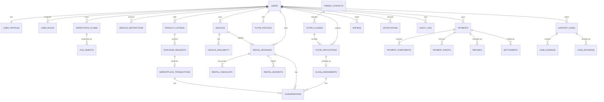

# CampusLoop Database Design

## 1. Design principles

- PostgreSQL is transactional source of truth.
- Model shared identity once; model Marketplace, Rental, and Tutoring lifecycles separately.
- Store current state for efficient reads and append business events for history.
- Enforce exclusive product/class holds and non-overlapping vehicle intervals in DB.
- Separate public data from sensitive evidence/contact data.
- Represent money as integer minor units plus ISO currency; never floating point.
- Preserve payment, decision, disclosure, and audit records.
- Keep unresolved policy values versioned and configurable.

## 2. Conceptual ERD



Polymorphic links shown conceptually should be implemented with explicit nullable foreign keys plus a check constraint, or separate junction tables. Do not use an unconstrained string-only `entity_id`.

## 3. Shared entity definitions

### 3.1 Identity, access, and trust

| Entity | Key fields | Notes |
|---|---|---|
| `users` | `id PK`, `email`, `phone`, `status`, `contact_verified_at`, `created_at`, `updated_at`, `version` | Unique normalized email/phone where present. Status: active, temporarily_restricted, locked. |
| `user_profiles` | `user_id PK/FK`, `display_name`, `legal_name_encrypted`, `school`, `major`, `study_year`, `approximate_area`, `bio` | Public DTO excludes legal/private fields. |
| `user_roles` | `(user_id, role) PK`, `granted_at`, `granted_by` | Roles are contextual; eligibility still depends on verification/restrictions. |
| `consents` | `id PK`, `user_id FK`, `document_type`, `document_version`, `accepted_at`, `ip_hash` | Terms/privacy and specific disclosure consent. |
| `verification_claims` | `id PK`, `user_id FK`, `claim_type`, `status`, `reviewed_by FK`, `reviewed_at`, `expires_at`, `reason_code` | Claim types remain precise: contact, student, identity, driving_licence, vehicle_rights, tutor_capability. |
| `verification_evidence` | `id PK`, `claim_id FK`, `file_id FK`, `evidence_type`, `metadata jsonb` | Private; no direct public URL. |
| `service_restrictions` | `id PK`, `user_id FK`, `service`, `level`, `reason_code`, `starts_at`, `ends_at`, `created_by FK`, `appeal_status` | Service nullable for global restriction. Appeal process is policy TBD. |
| `reputation_snapshots` | `user_id FK`, `service`, counts/averages, `calculated_at` | Derived read model; ratings/events remain truth. |
| `ratings` | `id PK`, `transaction_type`, explicit transaction FK, `reviewer_id FK`, `reviewee_id FK`, scores, `comment`, `status` | Unique reviewer per eligible transaction; moderated if abnormal. |
| `saved_items` | `id PK`, `user_id FK`, exactly one explicit product/vehicle/class FK, `created_at` | Bookmark only; grants no private access or transaction eligibility. Unique per user and target. |

### 3.2 Communication, files, support, and audit

| Entity | Key fields | Notes |
|---|---|---|
| `file_objects` | `id PK`, `owner_id FK`, `storage_key`, `classification`, `mime_type`, `size_bytes`, `checksum`, `scan_status`, `created_at` | Classification: public_listing, conditional_transaction, private_verification, private_dispute. |
| `conversations` | `id PK`, one explicit transaction FK, `created_at` | One transaction context; participants in junction table. |
| `conversation_participants` | `(conversation_id, user_id) PK`, `joined_at` | Enforce access. |
| `messages` | `id PK`, `conversation_id FK`, `sender_id FK`, `body`, `created_at`, `moderation_status` | Attachments through `message_files`. |
| `notifications` | `id PK`, `user_id FK`, `type`, `title`, `body`, `action_url`, `action_deadline`, `read_at`, `created_at` | In-app source record. |
| `notification_deliveries` | `id PK`, `notification_id FK`, `channel`, `status`, `attempts`, `provider_id`, `last_error` | Channel is technical/policy configuration. |
| `support_cases` | `id PK`, `opened_by FK`, `case_type`, `priority`, `status`, explicit transaction FK, `requested_outcome`, `assigned_to FK`, timestamps | Complaint tied to exact transaction whenever applicable. |
| `case_evidence` | `id PK`, `case_id FK`, `submitted_by FK`, `file_id FK`, `description`, `submitted_at` | Supports two-sided evidence. |
| `case_decisions` | `id PK`, `case_id FK`, `decided_by FK`, `policy_version_id FK`, `outcome`, `reason`, money fields, `created_at` | Admin or authorized operator only. |
| `business_events` | `id PK`, `aggregate_type`, `aggregate_id`, `event_type`, `actor_id FK`, `from_state`, `to_state`, `payload jsonb`, `created_at` | Append-only transaction timeline. |
| `audit_logs` | `id PK`, `actor_id FK`, `action`, `target_type`, `target_id`, `reason`, `request_id`, `before_hash`, `after_hash`, `created_at` | Append-only privileged actions. |
| `sensitive_access_logs` | `id PK`, `actor_id FK`, `resource_type`, `resource_id`, `purpose`, `created_at` | Required for parent/identity/exact-location access. |
| `outbox_events` | `id PK`, `topic`, `aggregate_id`, `payload jsonb`, `available_at`, `processed_at`, `attempts` | Transactional outbox for jobs/notifications. |

## 4. Marketplace entities

| Entity | Key fields | Notes |
|---|---|---|
| `product_listings` | `id PK`, `seller_id FK`, `category_id FK`, `title`, `description`, `condition`, `faults`, `accessories`, `price_minor`, `currency`, `approximate_area`, `status`, `moderation_reason`, `published_at`, `version` | States: draft, pending_review, needs_changes, active, held, sold, hidden_cancelled. |
| `product_images` | `(listing_id, file_id) PK`, `sort_order` | At least one real image is a validation rule; exact minimum is policy/product TBD. |
| `listing_moderation_reviews` | `id PK`, `listing_id FK`, `reviewer_id FK`, `decision`, `reason_code`, `notes`, `created_at` | Full decision history. |
| `purchase_requests` | `id PK`, `listing_id FK`, `buyer_id FK`, `status`, `message`, `created_at`, `withdrawn_at`, `expires_at` | Status: pending, withdrawn, accepted, rejected, expired. |
| `marketplace_transactions` | `id PK`, `listing_id FK`, `purchase_request_id FK`, `seller_id FK`, `buyer_id FK`, `status`, `hold_expires_at`, `agreed_price_minor`, handover fields, confirmation timestamps, `completed_at`, `cancel_reason`, `version` | One active transaction/hold per listing. Exact location belongs in conditional/private storage. |

### Marketplace relationships and constraints

- `product_listings.seller_id → users.id`.
- `purchase_requests.listing_id → product_listings.id`; buyer cannot equal seller.
- `marketplace_transactions.purchase_request_id` is unique.
- Partial unique index on `marketplace_transactions(listing_id)` where state is active/held/handover_pending/review.
- Completion requires seller and buyer confirmation; admin override is recorded as event/decision.

## 5. Rental entities

| Entity | Key fields | Notes |
|---|---|---|
| `vehicles` | `id PK`, `owner_id FK`, public vehicle attributes, encrypted/full plate reference, `approximate_area`, `rental_terms`, price/deposit fields, `status`, `version` | States include draft, pending_review, needs_changes, active, suspended, blocked. |
| `vehicle_documents` | `id PK`, `vehicle_id FK`, `file_id FK`, `document_type`, `verification_status`, `expires_at` | Private. |
| `vehicle_availability` | `id PK`, `vehicle_id FK`, `slot tstzrange`, `kind`, `created_by FK` | `kind`: owner_available, owner_block, maintenance_block. |
| `rental_bookings` | `id PK`, `vehicle_id FK`, `owner_id FK`, `renter_id FK`, `requested_period tstzrange`, `reserved_period tstzrange`, `status`, `payment_deadline`, price/deposit/platform-fee snapshots, policy version, confirmation timestamps, `version` | Booking state machine and immutable financial snapshot. |
| `rental_checklists` | `id PK`, `booking_id FK`, `phase`, kilomet/fuel/accessory/safety values, `owner_confirmed_at`, `renter_confirmed_at`, `actual_at` | `phase`: handover or return. |
| `rental_condition_items` | `id PK`, `checklist_id FK`, `item_type`, `condition`, `notes` | Scratches, mirror, lights, tyres, brakes, lock, accessories. |
| `rental_evidence` | `id PK`, `booking_id FK`, `checklist_id FK nullable`, `file_id FK`, `phase`, `captured_at`, `submitted_by FK` | Before, after, incident evidence. |
| `rental_incidents` | `id PK`, `booking_id FK`, `type`, `severity`, `status`, `reported_by FK`, `occurred_at`, `description`, `resolved_at` | Breakdown, accident, loss, penalty, no-contact, other. |
| `rental_extensions` | `id PK`, `booking_id FK`, proposed range/amounts, `status`, owner decision timestamps | Approved only if no future conflict and owner agrees. |
| `deposit_decisions` | `id PK`, `booking_id FK`, `case_id FK`, `decision`, `deduction_minor`, `reason`, `decided_by FK`, `created_at` | None/partial/full within approved policy. |

### Rental overlap protection

Use `btree_gist` and a generated/explicit blocking range:

```sql
CREATE EXTENSION IF NOT EXISTS btree_gist;

ALTER TABLE rental_bookings
ADD CONSTRAINT rental_bookings_no_overlap
EXCLUDE USING gist (
  vehicle_id WITH =,
  reserved_period WITH &&
)
WHERE (status IN (
  'AWAITING_PAYMENT',
  'READY_FOR_HANDOVER',
  'HANDOVER_REVIEW',
  'IN_PROGRESS',
  'RETURN_REVIEW',
  'DISPUTED'
));
```

Include configured operational buffer in `reserved_period`; keep requested user interval separately.

## 6. Tutoring entities

| Entity | Key fields | Notes |
|---|---|---|
| `parent_contacts` | `id PK`, encrypted contact/name/address fields, consent fields, `verified_at`, `verified_by FK`, `source_quality_status` | Private/admin-only until authorized disclosure. Parent user ID may be nullable for MVP. |
| `tutor_profiles` | `user_id PK/FK`, public introduction, subjects/grades/areas/formats, availability summary, status, `version` | Detailed availability can use child rows. |
| `tutor_credentials` | `id PK`, `tutor_id FK`, `type`, `file_id FK`, `status`, `reviewed_by FK`, `expires_at` | Verification label derives from reviewed evidence. |
| `tutor_classes` | `id PK`, `public_code`, `parent_contact_id FK`, public subject/grade/goal/schedule/area/format/tuition fields, private notes, acceptance-fee snapshot/config ref, `status`, `last_parent_confirmed_at`, `version` | Public DTO excludes parent identity/contact/exact address/student identifiers. |
| `tutor_applications` | `id PK`, `class_id FK`, `tutor_id FK`, `introduction`, `status`, `submitted_at`, `withdrawn_at`, `screening_notes` | Unique class+tutor. |
| `class_assignments` | `id PK`, `class_id FK`, `application_id FK`, `tutor_id FK`, `status`, `hold_expires_at`, `fee_minor`, `currency`, `policy_version_id FK`, `selected_by FK`, `contact_disclosed_at`, contact/trial/teaching timestamps, `version` | Only one active selected/paid assignment per class. |
| `parent_feedback_records` | `id PK`, `class_id FK`, `application_id FK nullable`, `recorded_by FK`, `feedback`, `source_confirmed_at` | Admin records MVP parent response. |
| `contact_disclosures` | `id PK`, `assignment_id FK`, `tutor_id FK`, `fields_disclosed`, `purpose`, `created_at` | Append-only proof of protected reveal. |

### Tutoring relationships and constraints

- One parent contact can request many classes.
- One tutor can submit at most one application per class.
- One application can become at most one assignment.
- Partial unique index on `class_assignments(class_id)` for held/paid/contact/trial/teaching active states.
- Contact disclosure requires matching selected tutor, successful fee payment, allowed assignment state, and no blocking restriction.

## 7. Payments and policy entities

| Entity | Key fields | Notes |
|---|---|---|
| `policy_versions` | `id PK`, `service`, `policy_type`, `version`, `effective_from`, `effective_to`, `status`, `rules jsonb`, `approved_by FK` | Draft values cannot govern production transactions. |
| `payments` | `id PK`, `payer_id FK`, explicit transaction FK, `purpose`, `status`, `total_minor`, `currency`, `provider`, `provider_reference`, `idempotency_key`, timestamps | Purpose: rental_checkout, tutor_acceptance_fee, etc. |
| `payment_components` | `id PK`, `payment_id FK`, `type`, `amount_minor`, `beneficiary_type/id`, `hold_rule` | Rent, deposit, platform fee, adjustment. Sum must equal payment total. |
| `payment_events` | `id PK`, `payment_id FK`, `provider_event_id UNIQUE`, `type`, `payload_hash`, `received_at`, `processed_at` | Keep minimal secure raw metadata per retention policy. |
| `refunds` | `id PK`, `payment_id FK`, `case_decision_id FK nullable`, `amount_minor`, `status`, `provider_reference`, timestamps | Track processing through confirmed result. |
| `settlements` | `id PK`, `payment_id FK`, `beneficiary_user_id FK`, `amount_minor`, `status`, `provider_reference`, timestamps | Owner/platform settlement. |
| `ledger_entries` | `id PK`, `transaction_group`, `account_code`, `direction`, `amount_minor`, `currency`, `created_at` | Recommended immutable double-entry ledger for held, refundable, payable, refunded, settled balances. |

### Money constraints

- All amounts `bigint >= 0`; currency `char(3)`.
- Sum of components equals payment total.
- Refund total cannot exceed captured refundable amount.
- Settlement cannot exceed eligible component after refunds/deductions.
- Provider events and client mutations use unique idempotency keys.
- Financial terminal state requires provider/reconciliation confirmation, not local intent alone.

## 8. Primary and foreign keys

- UUID PKs generated by application or `gen_random_uuid()`.
- All dependent lifecycle rows use `ON DELETE RESTRICT`; user/content hiding uses status, not destructive cascade.
- Pure junction and delivery-attempt rows may use controlled cascade when parent deletion is legally and operationally allowed.
- Sensitive records should support crypto-shredding/anonymization policy without breaking audit referential integrity.
- Add `created_at`, `updated_at`, and `version` to mutable aggregates.

## 9. Recommended indexes

| Table | Index |
|---|---|
| `users` | Unique normalized email; unique normalized phone; `(status, created_at)`. |
| `verification_claims` | `(user_id, claim_type, status)`; partial on pending reviews. |
| `product_listings` | `(status, published_at DESC)`; `(category_id, status)`; `(seller_id, status)`; GIN full-text title/description; area/price filter composite based on query analysis. |
| `purchase_requests` | `(listing_id, status, created_at)`; `(buyer_id, status, created_at DESC)`. |
| `marketplace_transactions` | Partial unique active listing; `(buyer_id, status)`; `(seller_id, status)`; `(hold_expires_at)` partial for expirable state. |
| `vehicles` | `(status, approximate_area)`; `(owner_id, status)`; vehicle search attributes as measured. |
| `vehicle_availability` | GiST `(vehicle_id, slot)` or separate vehicle B-tree plus slot GiST. |
| `rental_bookings` | GiST exclusion above; `(renter_id, status)`; `(owner_id, status)`; partial indexes on payment deadline and scheduled return. |
| `tutor_classes` | `(status, published_at DESC)`; subject/grade/area/format; GIN search if needed; partial active class index. |
| `tutor_applications` | Unique `(class_id, tutor_id)`; `(class_id, status)`; `(tutor_id, status)`. |
| `class_assignments` | Partial unique active class; partial `(hold_expires_at)` for awaiting payment/contact. |
| `support_cases` | `(status, priority, created_at)`; `(assigned_to, status)`; each explicit transaction FK. |
| `notifications` | `(user_id, read_at, created_at DESC)`; partial unread. |
| `outbox_events` | Partial `(available_at)` where `processed_at IS NULL`. |
| `payment_events` | Unique provider event ID; `(payment_id, received_at)`. |
| `audit_logs` | `(target_type, target_id, created_at)`; `(actor_id, created_at)`; time partition key if volume requires. |

Use `EXPLAIN (ANALYZE, BUFFERS)` against pilot-like data before adding speculative composites.

## 10. PostgreSQL-specific considerations

- Enable `pgcrypto` for UUIDs/selected encryption support and `btree_gist` for range exclusions.
- Use `tstzrange` for rental intervals; standardize half-open `[start,end)` ranges.
- Store timestamps in UTC; localize in client using user/pilot timezone.
- Use DB transactions with `SELECT ... FOR UPDATE` for accepting purchase requests, rental holds, and class selection.
- Use `version` for optimistic concurrency on user-facing updates.
- Prefer check constraints or lookup tables for stable enums; migrations must support state additions safely.
- Use `jsonb` only for variable policy/provider/evidence metadata; business-query fields remain typed columns.
- Use GIN full-text indexes for Vietnamese/selected language only after tokenizer/search behavior is validated; fallback trigram search may be evaluated.
- Consider monthly partitioning for audit, notification delivery, business event, and provider event tables after measured growth.
- Do not log decrypted sensitive fields or signed URLs.
- Configure connection pooling; cap application connections below RDS limits.
- Use PITR backups and tested restores; exact retention/RPO/RTO remain TBD.

## 11. State storage pattern

For each aggregate:

- `status` stores current state.
- `version` detects stale writes.
- specific timestamps capture important facts (`paid_at`, `handover_at`, `contact_disclosed_at`).
- `business_events` stores append-only transition history.
- `policy_version_id` snapshots governing policy.
- financial amounts are snapshotted on transaction/assignment, so later policy edits do not retroactively alter agreements.

## 12. Data classification

| Classification | Examples | Access |
|---|---|---|
| Public | Display name, opted-in school/major, trust summary, product photos/description, vehicle public data, anonymized class data. | Public API with moderation/state filters. |
| Conditional | Exact meeting point, transaction contact, complete plate where justified, selected parent contact. | Authorized participants in correct state; log sensitive access. |
| Private operational | Identity documents, driving licence, vehicle papers, tutor evidence, parent consent record, dispute evidence. | Assigned operator/admin or verification process only. |
| Financial/audit | Provider refs, payment/refund/settlement, decisions, access logs. | Narrow finance/admin roles and system services. |

Retention, deletion, anonymization, and legal basis must be finalized before public launch.
