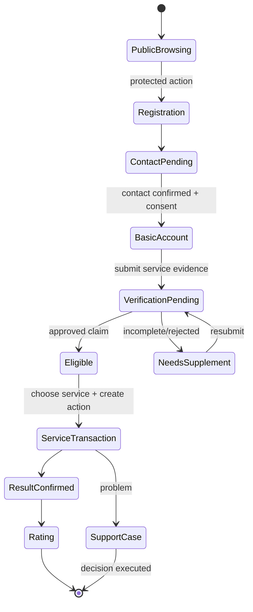
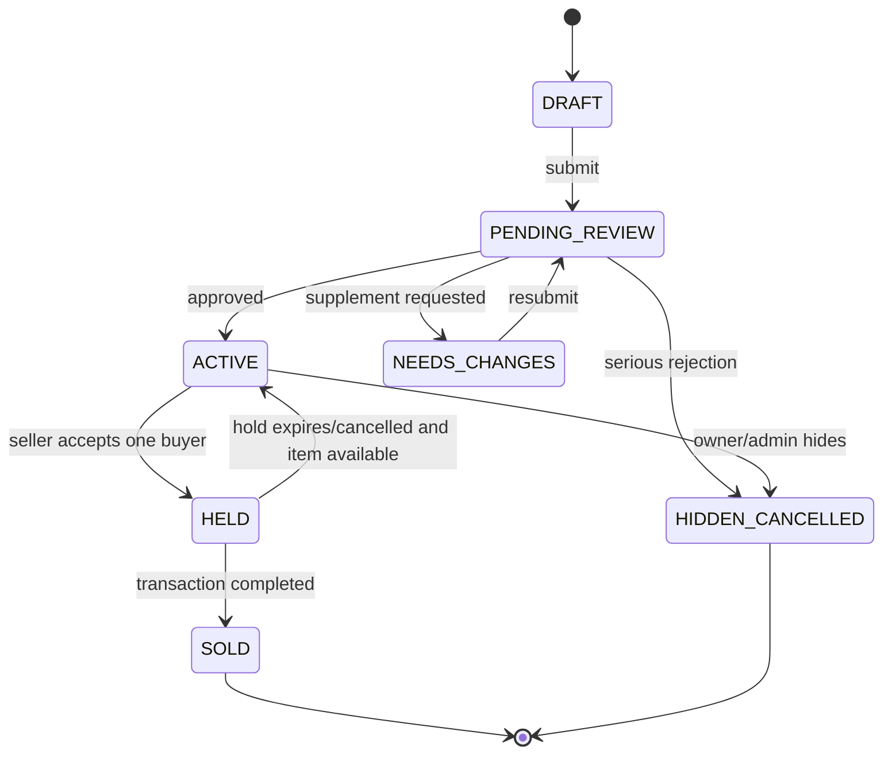
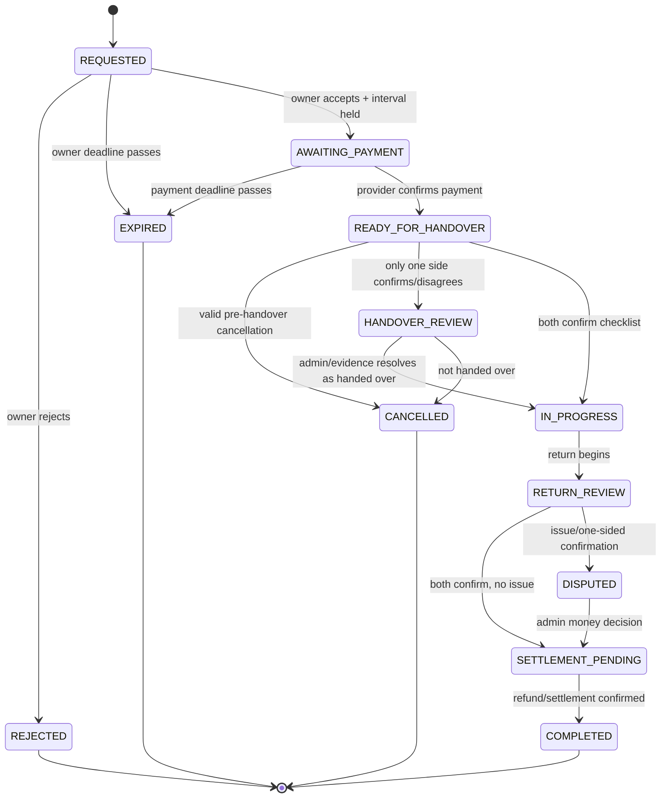
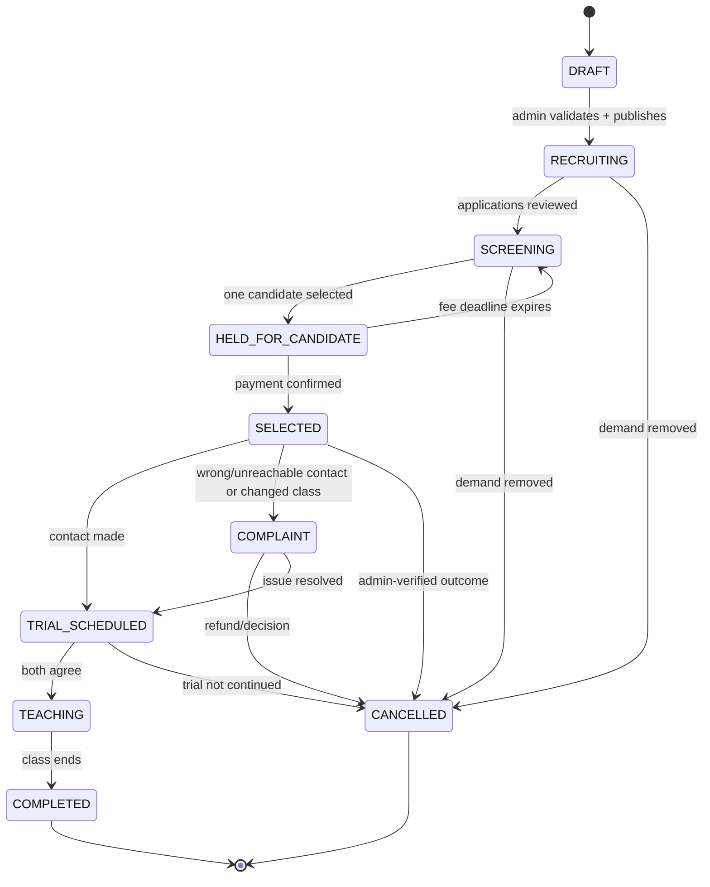
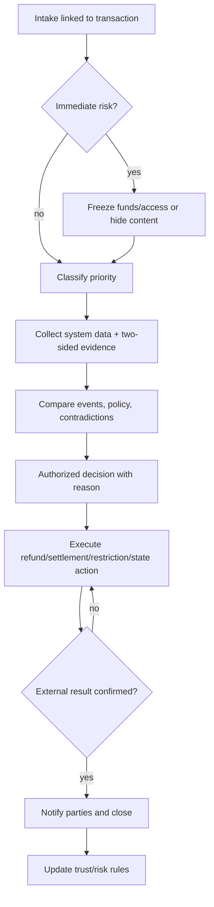

# CampusLoop User Flows

## 1. Shared user journey

### Journey steps

1. Visitor views only permitted public content.
2. Protected action redirects to registration/login.
3. User supplies basic information, confirms contact method, accepts terms/privacy.
4. User completes service-relevant verification.
5. User creates a listing/request/booking/application.
6. System enforces service-specific lifecycle and disclosure gates.
7. Participants confirm actual result.
8. Eligible participants rate each other or open transaction-linked support.

### Shared edge cases

- Contact challenge expires or is re-sent.
- Verification evidence is missing, unreadable, inconsistent, expired, or only proves a narrower claim.
- User becomes restricted while a transaction is open: block new activity, preserve data, route current transaction to operations.
- Sensitive field requested before state/role permits: return concealed/not-authorized response and log attempt as appropriate.
- Notification delivery fails: retain in-app notification; retry configured external channel.
- User reports urgent safety/privacy issue: raise priority, preserve/limit access immediately, then gather evidence.

## 2. Marketplace workflow

### 2.1 Seller listing

Seller flow:

1. Verify contact/eligibility.
2. Add real images, category, condition, faults, accessories, price, approximate area.
3. Preview truthful-information confirmation and submit.
4. Operator approves, requests specific supplement, or rejects/hides for violation.
5. Respond to buyer questions inside platform.
6. Accept one purchase request; item becomes exclusive hold.
7. Reconfirm product condition, agree safe meeting point/time, prepare item/evidence.
8. Hand over actual listed item and confirm delivery/payment receipt as applicable.
9. Rate buyer after completed transaction.

### 2.2 Buyer purchase

1. Filter by keyword/category/price/condition/area.
2. Review listing, images, seller trust, approximate handover conditions.
3. Ask questions inside platform.
4. Submit purchase request; withdraw freely before seller acceptance.
5. After selection, review final price/description and attend agreed public/safe meeting point.
6. Inspect condition, quantity, accessories, and operation before payment.
7. If details changed, explicitly agree or refuse.
8. Pay agreed method and confirm receipt.
9. Rate seller or open complaint.

### 2.3 Marketplace exceptions

| Situation | Transition/action |
|---|---|
| Buyer changes mind before acceptance | Withdraw request; listing remains active; no/light trust impact unless abuse. |
| Seller holds then sells elsewhere | Cancel; reopen if available; verified seller trust impact. |
| No-show | Other party reports time/message evidence; operator reviews before trust impact/reopen. |
| Product materially differs | Buyer may refuse; listing may be hidden; investigate seller. |
| Mutual cancellation | Close unsuccessful and reopen; no trust impact absent abuse. |
| One party refuses confirmation | Move to review; operator checks messages/evidence, never assumes first confirmer is correct. |
| Prohibited/fake/harassing behavior | Hide listing, preserve evidence, restrict as policy permits. |

## 3. Motorbike Rental workflow

### 3.1 Vehicle onboarding

1. Owner completes identity and right-to-rent verification.
2. Owner records vehicle attributes, price, expected deposit, conditions, fuel/distance/use limits, area, photos, and private documents.
3. Owner publishes availability with inspection/maintenance buffer.
4. Operator verifies owner, vehicle rights, safety/document information, and pricing conditions.
5. Approved vehicle becomes searchable; owner blocks schedule during repair/unavailability.

### 3.2 Booking lifecycle

### 3.3 Renter journey

1. Complete identity, age/eligibility, and applicable licence verification.
2. Search exact start/end time, area, vehicle criteria.
3. Review photo, price, deposit, conditions, restrictions, owner trust, and cancellation policy.
4. State requested usage/area and handover preference where policy requires.
5. Review itemized charges and responsibilities; submit request.
6. If owner accepts, pay official request before deadline.
7. At handover, verify person by defined OTP/QR method; jointly document scratches, kilometre, fuel, safety items, locks, and accessories.
8. Confirm checklist only if agreed; then use within allowed terms.
9. Report breakdown, accident, loss, penalty, or no-contact immediately. Request extension before return.
10. Return at agreed point/time; jointly capture matching evidence and confirm.
11. Track deposit refund and transaction closure; rate or complain.

### 3.4 Owner journey

1. Review renter's permitted verification/trust context and requested use/time/place.
2. Accept only if ready to provide advertised vehicle; acceptance reserves interval.
3. Keep support contact available during rental; do not misuse location/contact.
4. Perform joint handover checklist and confirm.
5. Cooperate with incidents and lawful/safety actions.
6. Compare return against initial evidence; confirm receipt.
7. If damage exists, open complaint with specific amount/basis/evidence; do not unilaterally retain deposit.
8. Receive settlement only after return/dispute conditions clear.

### 3.5 Rental exceptions

| Situation | Immediate action | Next state/path |
|---|---|---|
| Payment expires/fails | Do not permit handover; reconcile if debit claimed. | Expire/open schedule, or wait for authoritative resolution. |
| Owner cancels near handover | Refund per published policy; support replacement if applicable. | Cancelled; stronger owner trust impact. |
| Breakdown | Stop safely; capture state; notify owner/admin. | Determine natural/pre-existing/user cause. |
| Accident | Safety/medical/authority first; preserve scene evidence; freeze settlement. | Incident/dispute policy and insurance/partner path. |
| Vehicle lost | Notify owner, admin, authority; freeze transaction/account as needed. | High-priority incident/investigation. |
| Penalty | Preserve incident and document. | Attribute by time/responsibility policy. |
| Extension | Request before return. | Approve only if owner agrees and no next booking. |
| One-sided handover/return | Do not assume first confirmer is correct. | Review OTP/QR, time, evidence, messages. |
| New damage alleged | Hold relevant deposit; compare before/after and repair basis. | Admin: none/partial/full permitted deduction. |
| Rental ends early after handover | Not normal cancellation. | Early-termination policy and settlement review. |

## 4. Tutor Connection workflow

### 4.1 Parent demand intake

1. Admin receives request through official channel.
2. Admin verifies genuine demand, representative authority, and consent.
3. Admin records subject, grade, goal, schedule, location/format, expected tuition, start, and special requirements.
4. Admin explains public versus protected information.
5. Admin resolves ambiguity and confirms class remains needed.
6. Admin publishes anonymized class; stores source and last confirmation.

### 4.2 Tutor application and assignment

Tutor flow:

1. Create profile with school, major/year, subjects/grades, area, schedule, format, experience, introduction, and optional evidence.
2. Operator checks only claims represented by verification labels.
3. Search classes by documented filters.
4. Review class details, acceptance fee, refund conditions, and update time.
5. Submit class-specific introduction and required evidence; track application ID/state.
6. Withdraw before selection if needed.
7. If selected, reconfirm all terms and pay official acceptance fee before deadline.
8. After provider-confirmed payment, request/retrieve protected parent contact.
9. Contact within policy deadline and update result.
10. Agree trial details and clarify tuition cycle, absence/makeup rules, and whether CampusLoop manages ongoing tuition.
11. Record trial/teaching/completion outcome; rate or request support.

Admin selection flow:

1. Filter by minimum subject, grade, schedule, area, and reasonable class requirements.
2. Review profile completeness, consistency, and exact verification claims.
3. Request supplement/interview if needed.
4. Share only parent-consented candidate information.
5. Record parent feedback.
6. Reconfirm class still exists and terms have not changed.
7. Select one candidate and create exclusive payment hold.
8. Keep/reject other applications per published policy.

### 4.3 Tutoring exceptions

| Situation | Required handling |
|---|---|
| Class already filled before contact reveal | Verify timeline with parent; full refund proposed by source, exact finalized policy governs. |
| Invalid/unreachable contact | Freeze class; admin rechecks official source; refund if source invalid under policy. |
| Parent changes before trial | Apply published refund rule, prioritizing tutor protection when tutor not at fault. |
| Class materially differs from listing | Tutor may refuse; compare public record and actual information; review refund. |
| Tutor withdraws after contact reveal | Apply published no/partial refund rule and trust impact. |
| Normal mismatch after trial | Distinguish ordinary lack of fit from false class data before refund decision. |
| Fee debit but payment state failed | Reconcile provider before asking tutor to pay again. |
| Candidate hold expires | Release class and permit admin to select another candidate. |
| Parent lacks account | Admin calls/confirms and records source/time; no invented parent action. |

## 5. Complaint and dispute workflow

Priority:

- **Emergency:** accident, vehicle loss, threat, sensitive-data exposure.
- **High:** charged money with wrong state, deposit dispute, fake class.
- **Medium:** non-response, late confirmation, schedule change.
- **Normal:** publishing/profile/status guidance.

Operator may supplement, temporarily preserve risk, gather evidence, and execute clearly delegated rules. Admin/higher authority decides long restrictions, disputed deductions/settlements, large or partial refunds, and exceptions.

## 6. UI state contract

Every transaction screen must show:

- human-readable state and meaning;
- next required action;
- actor responsible;
- deadline, if any;
- amount breakdown and hold/refund/release condition, if financial;
- latest relevant event and reason;
- allowed cancellation/support paths;
- link to transaction-specific support.

## 7. Cross-module edge rules

- One item, vehicle interval, or class hold must be exclusive and transactionally enforced.
- Timeout may release a hold only through published rule.
- Private information never appears in public search/detail responses.
- Confirmation records real event; it is not a generic “next” button.
- First party to confirm is not automatically treated as correct.
- Open disputes can freeze money, content, vehicle schedule, or access.
- Hiding/restricting does not delete evidence or open lifecycle data.
- Completed real transactions alone may create ratings.
- Policy changes do not retroactively alter already accepted transaction snapshots.
