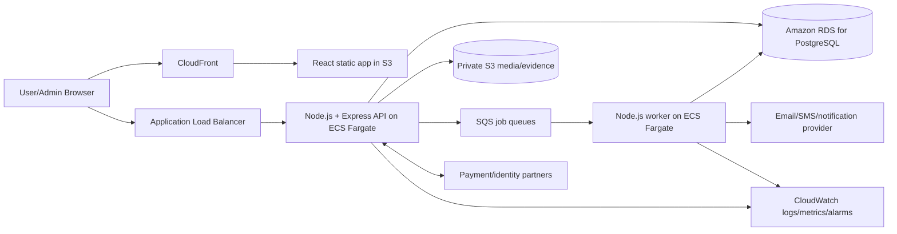
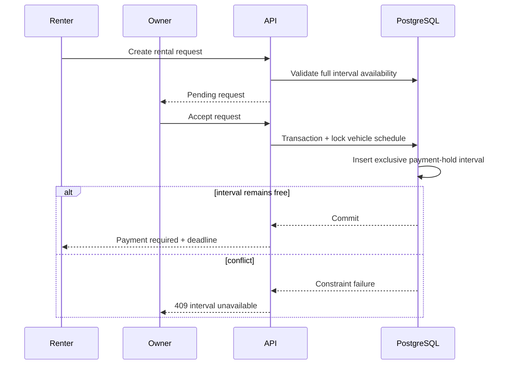

# CampusLoop System Architecture

## 1. Architecture goals

Architecture must preserve business gates, privacy, money integrity, and auditability across three distinct lifecycles. Recommended MVP style: **TypeScript modular monolith** with clear module boundaries. This limits operational complexity while allowing later extraction of high-load or high-risk components.

## 2. High-level architecture



### Logical layers

1. **React client** — public browsing, authenticated workflows, admin console.
2. **Express REST API** — authentication, authorization, validation, use cases, state transitions.
3. **PostgreSQL** — source of truth for users, lifecycles, money records, policies, audit.
4. **Object storage** — product/vehicle images and private verification/dispute evidence.
5. **Worker** — deadlines, reminders, notification delivery, payment reconciliation, reporting jobs.
6. **External adapters** — contact confirmation, payment, identity checks, and optional insurance/support partners.

## 3. Key architectural decisions and assumptions

| Decision | Rationale/status |
|---|---|
| REST API under `/api/v1` | Simple client/server contract; supports versioned change. |
| Modular monolith | MVP has coupled state, money, admin, and audit rules; one transactional boundary reduces inconsistency. |
| TypeScript end-to-end | Shared type discipline; not a product feature. |
| PostgreSQL as system of record | Required stack; supports transactions, constraints, range exclusion, JSONB, and full-text search. |
| Private object storage with signed access | Sensitive evidence must not be public. |
| Async worker and durable queue | Deadlines/notifications/reconciliation must survive API restarts. |
| Payment webhook plus reconciliation | Transfer screenshot cannot confirm payment; provider result is authoritative. |
| No direct client access to DB or private S3 | Authorization remains server-controlled. |
| Configured policy versions | Fees, durations, and outcomes are unresolved; approved values must be data/config, not scattered constants. |

Authentication mechanism and vendors remain technical choices. Recommended design uses short-lived access tokens and rotating server-managed refresh sessions in secure, HTTP-only cookies. This is an explicit security assumption, not a source requirement.

## 4. Frontend architecture

### 4.1 Application areas

- **Public:** service landing, Marketplace results/details, vehicle results/details, anonymized class results/details, safety/policy pages.
- **Authenticated user:** profile, verification center, notifications, conversations, support cases.
- **Marketplace workspace:** seller listings, buyer requests, held transaction, handover, confirmation, rating.
- **Rental workspace:** owner vehicles/calendar/requests; renter bookings/payment/handover/return/incidents.
- **Tutor workspace:** tutor profile, class search, applications, selection/payment, protected contact, trial/teaching status.
- **Operations console:** queues, moderation detail, complaint evidence, money reconciliation, restrictions, audit, metrics.

### 4.2 Recommended React structure

- Route-based code splitting by service and admin area.
- Server-state library or disciplined API hooks for queries, mutation, cache invalidation, and retry.
- Form library with schema validation; backend remains authoritative.
- Central authenticated session and permission context.
- State-specific action components driven by API-provided `allowedActions`, not client guesses alone.
- File uploader using server-issued signed upload URLs and post-upload registration.
- Common components for state badge, timeline, money breakdown, deadline, evidence gallery, sensitive-data gate, and reason display.
- Error boundary, not-found/forbidden screens, and accessible live status messages.

### 4.3 Frontend security rules

- Never embed private parent data, identity evidence, full plate data, exact addresses, or signed object URLs in public payloads.
- Render server-filtered DTOs; do not rely on CSS hiding.
- Do not store long-lived credentials or private evidence in `localStorage`.
- Require explicit confirmation for payment, cancellation after commitment, handover, return, dispute decision, and restriction.
- Display policy version and money conditions at financial consent points.

## 5. Backend architecture

### 5.1 Modules

| Module | Responsibility |
|---|---|
| `auth` | Registration, login, contact confirmation, refresh sessions, logout. |
| `users` | Profile, roles, status, service restrictions. |
| `verifications` | Claims, evidence, reviews, precise verification labels. |
| `access-control` | Role, ownership, service eligibility, state/action authorization. |
| `reputation` | Completed-transaction metrics, ratings, cancellations, verified complaints. |
| `marketplace` | Listings, requests, exclusive hold, handover, completion, cancellation. |
| `rental` | Vehicles, availability, requests, reservations, handover/return, incident, settlement. |
| `tutoring` | Parent intake, anonymized classes, tutor profiles, applications, selection, contact disclosure, trial/teaching. |
| `payments` | Payment intents, components, provider events, refunds, deposit decisions, settlements, reconciliation. |
| `conversations` | Transaction-scoped messages and attachments. |
| `notifications` | In-app messages, templates, reminders, delivery attempts. |
| `support` | Cases, complaints, evidence requests, decisions, actions. |
| `moderation` | Review queues, reason codes, content/vehicle/profile actions. |
| `policies` | Versioned fees, deadlines, cancellation/refund rules, effective dates. |
| `audit` | Append-only privileged and sensitive-access events. |
| `reporting` | Supply, funnel, speed, quality, trust, and finance aggregates. |
| `files` | Upload authorization, metadata, classification, malware-scan status, signed access. |
| `jobs` | Expiry, reminders, reconciliation, stuck-state detection. |

### 5.2 Request processing

Each mutation follows:

1. Authenticate.
2. Resolve actor, role, ownership, restrictions, and verification claims.
3. Validate body and referenced resources.
4. Load aggregate and policy version.
5. Check allowed transition and deadline.
6. Execute state change, business event, audit record, outbox message, and money record in one DB transaction.
7. Commit.
8. Worker publishes notification or calls external provider from durable outbox/queue.
9. Return filtered response with state, allowed actions, deadline, and correlation ID.

### 5.3 State machine enforcement

- State transitions live in domain services, not controllers.
- Each transition specifies actor, source states, guard conditions, target state, required evidence, and emitted events.
- Use row locks or optimistic version checks for exclusive holds and confirmations.
- Admin override requires dedicated permission, reason, policy reference, and audit record.
- Timeout workers call the same domain transition services as synchronous requests.

### 5.4 External integration boundaries

- Define provider interfaces for payment, contact delivery, identity verification, and object storage.
- Verify webhook signature, store raw event securely, deduplicate by provider event ID, and process idempotently.
- Never move to paid/ready/contact-revealed state from client-supplied success alone.
- Reconcile non-terminal provider operations until confirmed success or failure.

## 6. Database architecture

- Single PostgreSQL database for MVP with schemas or table prefixes by bounded context.
- UUID primary keys; UTC `timestamptz`.
- Normalized core entities plus JSONB only for variable evidence/provider metadata.
- Append-only `business_events`, `audit_logs`, and `payment_events`.
- Foreign keys and check constraints for ownership, amounts, and known states.
- Partial unique indexes enforce one active hold per product/class.
- Rental availability uses timestamp ranges and exclusion constraints to prevent overlap.
- Read views/materialized views may serve admin metrics; do not use them as transactional truth.
- DB migrations are reviewed, forward-deployable, and backed up before production schema changes.

Full design: [Database_Design.md](./Database_Design.md).

## 7. AWS deployment architecture

### 7.1 Production topology

| Concern | AWS service | Design |
|---|---|---|
| DNS/TLS | Route 53 + ACM | Public DNS and managed certificates. |
| Edge/protection | CloudFront + AWS WAF | Serve frontend/media; restrict common attacks and abusive traffic. |
| Frontend | Private S3 origin | Versioned React build; CloudFront origin access control. |
| API ingress | ALB | HTTPS, health checks, routing to private ECS tasks. |
| API/worker | ECS Fargate + ECR | Separate services/task definitions; autoscale from CPU/memory/queue depth. |
| Database | RDS PostgreSQL | Private subnets, encryption, automated backups, Multi-AZ for production. |
| Files | S3 | Separate public-derived and private-evidence prefixes/buckets; encryption, lifecycle, blocked public access. |
| Async jobs | SQS + dead-letter queue | Durable notifications, expiry, reconciliation. |
| Secrets | Secrets Manager/SSM Parameter Store | DB credentials, provider secrets, policy environment flags. |
| Observability | CloudWatch + CloudTrail | Logs, metrics, alarms, API activity. |
| Email | SES or adapter | Assumption; exact notification channels remain TBD. |

### 7.2 Network

- VPC across at least two Availability Zones.
- Public subnets: ALB only.
- Private application subnets: ECS API and worker.
- Isolated/private DB subnets: RDS.
- Security groups: internet → ALB; ALB → API; API/worker → DB; no public DB access.
- Controlled egress for external providers through NAT or approved alternative.

### 7.3 Environments

- Separate AWS accounts or strongly isolated VPC/resources for `dev`, `staging`, and `prod`.
- Separate DB, S3, queue, secrets, payment credentials, and DNS.
- Production data never copied to lower environments without approved anonymization.

### 7.4 Deployment flow

1. CI runs lint, type checks, unit/integration tests, dependency scan, and build.
2. Build immutable frontend artifact and backend container image.
3. Push image to ECR and frontend artifact to versioned S3 location.
4. Run migration as controlled one-off task.
5. Deploy ECS rolling update; verify health and smoke tests.
6. Promote CloudFront frontend version and invalidate only required paths.
7. Monitor errors, job queue, DB, and money webhooks; rollback application artifact if gates fail.

RTO, RPO, backup retention, Multi-AZ requirements outside production, and target availability remain **TBD engineering/policy**.

## 8. Request flows

### 8.1 Protected tutor contact disclosure

```mermaid
sequenceDiagram
    participant T as Tutor React App
    participant A as Express API
    participant P as Payment Provider
    participant D as PostgreSQL
    participant S as Private Data Store

    T->>A: POST class fee payment intent
    A->>D: Validate selected hold + policy; create intent
    A-->>T: Provider checkout data
    P->>A: Signed payment-success webhook
    A->>D: Deduplicate; mark paid; class = SELECTED
    T->>A: POST /contact-disclosures
    A->>D: Check same tutor + paid class + not restricted
    A->>D: Record disclosure audit
    A->>S: Resolve protected contact
    A-->>T: Minimal allowed contact data
```

### 8.2 Exclusive rental interval



## 9. Suggested repository structure

```text
/
├── apps/
│   ├── web/
│   │   ├── src/
│   │   │   ├── app/                 # routes, providers, layout
│   │   │   ├── features/
│   │   │   │   ├── auth/
│   │   │   │   ├── marketplace/
│   │   │   │   ├── rental/
│   │   │   │   ├── tutoring/
│   │   │   │   ├── support/
│   │   │   │   └── admin/
│   │   │   ├── components/
│   │   │   ├── api/
│   │   │   ├── hooks/
│   │   │   ├── schemas/
│   │   │   └── styles/
│   │   └── tests/
│   ├── api/
│   │   ├── src/
│   │   │   ├── app.ts
│   │   │   ├── server.ts
│   │   │   ├── config/
│   │   │   ├── middleware/
│   │   │   ├── modules/             # bounded contexts listed above
│   │   │   ├── infrastructure/      # postgres, queue, storage, providers
│   │   │   ├── jobs/
│   │   │   └── shared/
│   │   └── tests/
│   └── worker/
│       └── src/
├── packages/
│   ├── contracts/                   # API schemas/types, no secrets
│   ├── config/
│   └── test-support/
├── database/
│   ├── migrations/
│   ├── seeds/                       # synthetic data only
│   └── diagrams/
├── infrastructure/
│   ├── modules/
│   └── environments/
├── docs/
└── .github/workflows/
```

If frontend/backend remain separate repositories, preserve the same internal boundaries and keep API contracts versioned.

## 10. Architecture constraints

- No cross-module direct table mutation outside owning domain service.
- No state or financial transition based only on client display state.
- No public S3 ACL for private media/evidence.
- No hard-coded unresolved policy values.
- No deletion of evidence/audit history when restricting accounts or hiding content.
- No automatic dispute conclusion based solely on which party confirmed first.
- No contact reveal before the exact authorized gate.
